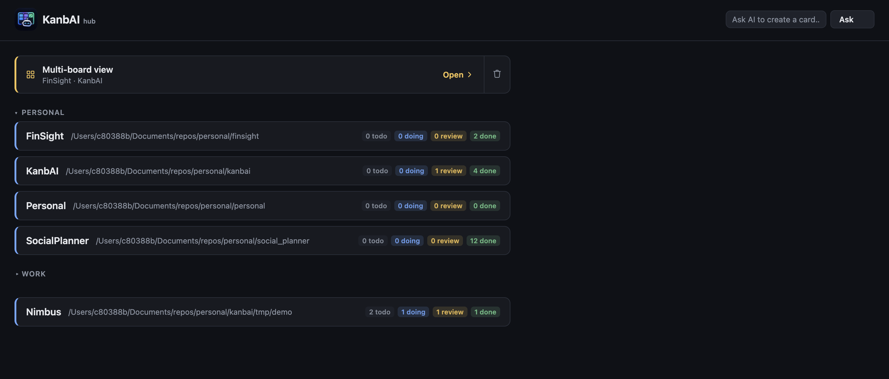
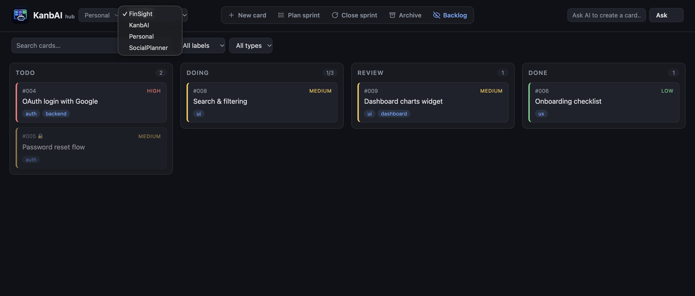
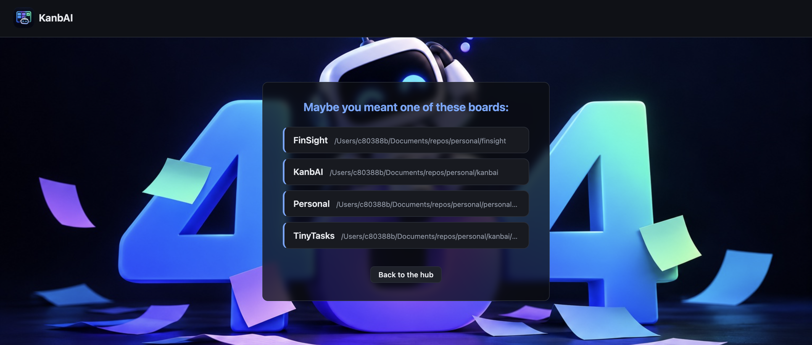
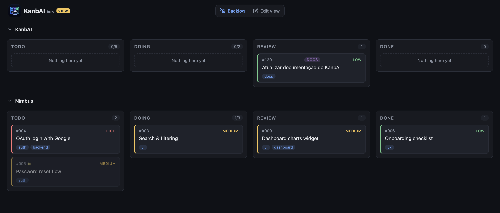

# Multi-board hub

Working across several projects? The **hub** serves all of their boards from one place, on a
single port, with a board switcher — no more one server per project.

## Install globally

Since the hub spans projects, install KanbAI **globally** rather than into a single project
(and include the [`ui` extra](installation.md#the-web-ui-extra)):

```bash
pipx install 'kanbai[ui]'
# or run it without installing anything:
uvx --from 'kanbai[ui]' kanbai hub
```

## Register your boards

Each board must already have a `.kanbai/` folder — run [`kanbai init`](cli.md#init) there
first. Then register it with the hub:

```bash
kanbai hub add ~/projects/api          # named after `[board] name` in its config.toml
kanbai hub list                        # show registered boards
kanbai hub remove api                  # unregister
```

## Serve them

```bash
kanbai hub                     # serve all registered boards; opens a landing to pick one
kanbai hub --port 9000 --no-browser
```

The hub root is a landing page that lists every registered board:



Each board is served at `/b/<name>/`, and a **board switcher** in the top bar lets you jump
between boards without leaving the page:



Visiting an unregistered or misspelled board URL shows a themed 404 page — with the
registered boards listed as suggestions — instead of a bare JSON error. A board whose
`.kanbai/config.toml` can't be read (a missing folder, or a permissions issue — e.g. macOS
denying a detached daemon access to a protected folder like `~/Documents`) is skipped with
a warning rather than taking every other board down with it.



## Categories and card counts

Every board row on the landing page shows how many cards sit in `todo`, `doing`, `review` and
`done`, read from disk on every request so the numbers are never stale.

Set a `category` in a board's [`config.toml`](configuration.md#board) to group related projects:

```toml
[board]
name = "api"
category = "Work"
```

Boards sharing a category are listed together under a collapsible heading on the landing page
(boards without one stay in an ungrouped list), and the board switcher gets a **category
filter** once there is more than one category, so a long list of boards stays navigable.

## Multi-board view

Want several boards on one screen? Use **Create multi-board view** at the top of the landing
page, tick the boards to include (you can filter the list, and each board's category is shown),
and save. The hub then has a single **view** at `/v/` with every chosen board's columns stacked
one under the other:

- each board is a collapsible section, with a link through to the full board;
- a toggle shows or hides the backlog columns for the whole view;
- cards can be opened, moved and edited right there, and the view **updates live** when you
  (or Claude, from the CLI) move a card on any of its boards;
- the **edit** button changes which boards are in it, and the landing page's delete button
  removes the view (the boards themselves are untouched).



There is one view per hub; its board list is stored in `~/.kanbai/view.toml`, next to the
registry.

## AI command input

When an [AI key is configured](web-ui.md#ai-command-input), the landing page has the same
natural-language input as a board's top bar. Since the hub spans projects, the instruction can
also say which board the card belongs to (*"add a bug card to the api board about the login
timeout"*); it pre-fills the **New card** form for you to confirm, and never creates the card
by itself.

## Running the hub in the background

`kanbai hub` blocks the terminal it runs in. To keep it always available without tying up a
terminal, run it as a background daemon instead:

```bash
kanbai hub start --port 8000   # start it, detached
kanbai hub status              # check whether it's running
kanbai hub status --json       # machine-readable
kanbai hub logs                # show its log
kanbai hub logs -f             # follow it
kanbai hub stop                # stop it
```

The daemon's PID and log file live under `~/.kanbai/` (`hub.pid` / `hub.log`), alongside the
registry. `kanbai hub start` refuses to run if a daemon is already running; `kanbai hub
stop` sends a graceful shutdown signal and escalates if it doesn't exit in time.

## Where the registry lives

The list of registered boards is stored in `~/.kanbai/boards.toml`. Override the location by
setting the `KANBAI_HOME` environment variable (handy for tests or isolated setups):

```bash
KANBAI_HOME=/tmp/kanbai-home kanbai hub list
```
